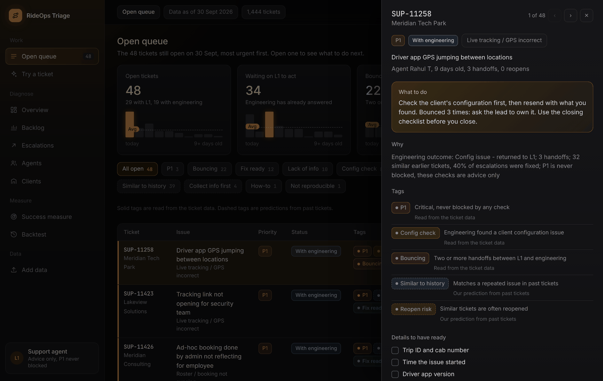
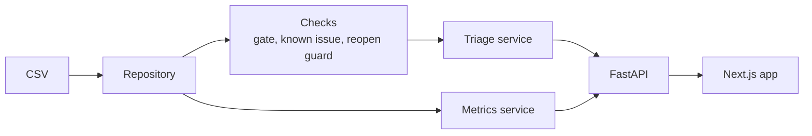

<div align="center">

# RideOps Triage

**Tells a support agent what to do with every open ticket, and shows the lead why the backlog keeps growing.**


</div>

---

## The problem

RideOps support is "drowning": open tickets are up about 60% since July. This tool finds out why and helps the L1 agent act on it.
It is a v0 built on the two CSV files from the case study (1,444 tickets, 2 Jul to 30 Sep 2026).

## What the data says

| Finding | Number |
|---|---|
| Ticket volume, July to September | **+52%** (390 to 592) |
| Escalations that were not real fixes | **57%** (275 of 486) |
| Median time to close, 0 handoffs vs 3 | **12.6h vs 169.9h** |
| Open tickets waiting on L1, not engineering | **34 of 48** |
| Fastest agent's reopen rate (team: 11%) | **30%** |

The backlog grows from more volume plus an escalate-and-bounce loop, not only from slow engineering.

## Pages

| Page | For | What it shows |
|---|---|---|
| **Open queue** | L1 agent | Open tickets with tags and one recommended action. Click a ticket for the details |
| **Try a ticket** | L1 agent | Type a new issue and see what to collect before escalating |
| **Overview** | Everyone | The four findings above |
| **Backlog** | Lead | Created, closed and open per week. Which categories grew |
| **Escalations** | Lead | How escalations ended and what each handoff costs |
| **Agents** | Lead | Speed next to escalation and reopen rates |
| **Clients** | Lead | Whether one client drives escalations |
| **Success measure** | Lead, Head of Ops | Weekly baseline, latest and target for six measures |
| **Backtest** | Lead | Would the predictions have worked in the past? |
| **Datasets** | Lead | Pick which data to analyse. Upload more months |

<table>
<tr>
<td width="50%"><br><sub><b>Open queue</b>: what to do, why, and what to collect</sub></td>
<td width="50%"><br><sub><b>Success measure</b>: tracked week by week</sub></td>
</tr>
</table>

## Quick start

**Docker** (starts everything)

```bash
docker compose up --build
```

Open http://localhost:3000. API docs are at http://localhost:8000/docs.

**Without Docker** (two terminals, backend first)

```bash
# 1. backend
cd backend
python -m venv .venv && source .venv/bin/activate    # Windows: .venv\Scripts\activate
pip install -r requirements.txt
uvicorn app.main:app --reload --port 8000

# 2. frontend
cd frontend
npm install
cp .env.example .env.local                           # Windows: copy .env.example .env.local
npm run dev
```

Needs Python 3.10+ and Node 20+. Check it works: http://localhost:8000/api/health should return `"tickets":1444`.

## Choose your data

Open **Datasets**. Every CSV is a dataset, and you tick the ones every page should analyse.


| Dataset | Where it lives |
|---|---|
| **Original data** (Jul to Sep 2026) | `backend/data/rideops_support_tickets.csv` |
| **Anything you upload** | `backend/data/uploads/*.csv`, one file per upload |

- **See it:** open the `backend/data/uploads/` folder. Each upload is a file there.
- **Delete it:** delete the file, and the app stops using it. No restart. (The Delete button on the page does the same.)
- **Drop one in:** copy a CSV into that folder and it appears on the page.
- **Mix them:** tick one month, or all. If two files have the same ticket ID, the newer file wins, so a later export can close old tickets.
- **Untick the original** to analyse only your new data.

**To upload:** choose a file, press **Check file**, review, then **Save and use**.
Problems are listed by row and column, and nothing is saved until you confirm.

"Today" is the latest date in the chosen data. You can set a "data pulled on" date instead.

> Docker: `backend/data/uploads` is mounted into the container, so the files appear on your machine.
> On Linux, if saving fails, run `chmod a+rwx backend/data/uploads`.

## Tags

Solid tags are **facts** from the data. Dashed tags are **predictions** from past tickets.

| Tag | Meaning |
|---|---|
| Lack of info, Config check, Duplicate, How-to, Not reproducible | Engineering sent it back for this reason |
| Fix ready | Engineering fixed it, so confirm and close |
| Bouncing | 2 or more handoffs between L1 and engineering |
| Reopened, P1 | Reopened before, or critical (never held) |
| Similar to history | Same issue as many earlier tickets |
| Collect info first | This category often comes back for info |
| Reopen risk | Similar tickets are often reopened |

All advice is a suggestion. Nothing is blocked.

## How it works



- **Backend** (`backend/`): FastAPI and pandas. No database.
- **Frontend** (`frontend/`): Next.js App Router. Number pages are server components. Queue, Try and Backtest are interactive.
- **Learning is counting**: repeated issues, return rates and reopen rates. No machine learning.

<details>
<summary>Project structure</summary>

```
backend/
  app/
    api/           routes: queue, metrics, backtest, data
    checks/        EscalationGate, KnownIssueMatcher, ReopenGuard
    models/        Ticket, Verdict
    repository/    the only code that reads the CSV
    services/      triage, metrics, history learner, backtester, datasets, feedback
    config.py      thresholds and assumptions
  data/            the original CSV files
    uploads/       your uploaded CSVs (one file each)
  tests/           51 tests
frontend/
  app/             one folder per page
  components/      charts, drawer, forms, sidebar
  lib/             types, formatting, API helpers
docs/screenshots/  images used in this README
```

</details>

<details>
<summary>API</summary>

| Endpoint | Returns |
|---|---|
| `GET /api/health` | Status and ticket count |
| `GET /api/queue` | Open tickets with tags and advice |
| `POST /api/triage` | Advice for a typed ticket |
| `POST /api/feedback` | Agent agrees or disagrees |
| `GET /api/metrics/*` | `summary`, `weekly`, `yield`, `bounce`, `agents`, `categories`, `category-trend`, `top-clients`, `success` |
| `GET /api/backtest?split=YYYY-MM-DD` | Backtest result |
| `GET /api/data/status` | Every dataset, which are in use, and what they add up to |
| `POST /api/data/upload?dry_run=true&name=file.csv` | Check a CSV (send it as the body). Use `false` to save it in the uploads folder |
| `PUT /api/data/selection` | Choose datasets: `{"selected": ["original", "file.csv"]}`. Optional `"as_of"` date |
| `DELETE /api/data/datasets/{file}` | Delete an uploaded file |

</details>

## Tests

```bash
cd backend && python -m pytest -q      # 51 passed
cd frontend && npm run typecheck
```

The tests recompute the headline numbers straight from the raw CSV and cover datasets (tick, upload, delete a file from the folder), bad input and "no future data in the backtest".

## Honest limits

- **The predictions are not proven.** Learning from July and August and replaying September, flagged tickets were avoidable 48% of the time against 59% for all escalations (lift 0.81). So the predictive tags are advice only. The fact tags are as reliable as the CSV.
- The "details to have ready" checklists are written from domain knowledge. The CSV does not say what engineering was missing.
- Success targets are suggestions to agree with the business.
- Not built on purpose: live ticket intake, user accounts, notifications, hard blocks on escalation.

## Next four weeks

1. **Week 1.** Pilot the queue with two agents. Track the Agree rate.
2. **Week 2.** Make "what was missing" a required field when engineering returns a ticket.
3. **Week 3.** Build a known-issue registry. Re-run the backtest.
4. **Week 4.** Compare 4-week averages of avoidable escalations (baseline 56%), bounces and reopens.

Success means avoidable escalations and bounces fall while reopens stay flat, not only a lower open count.
