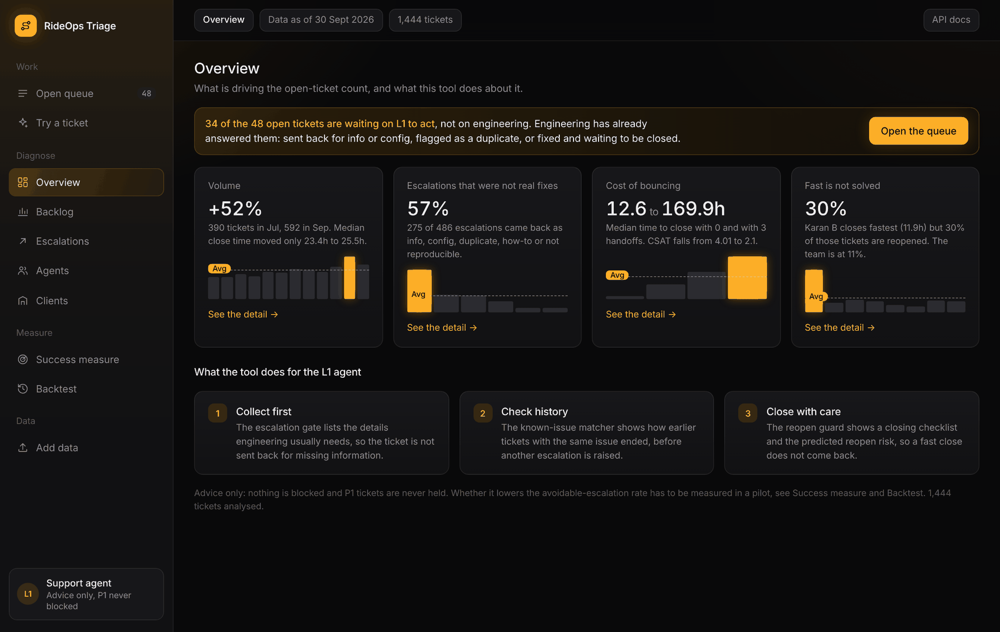
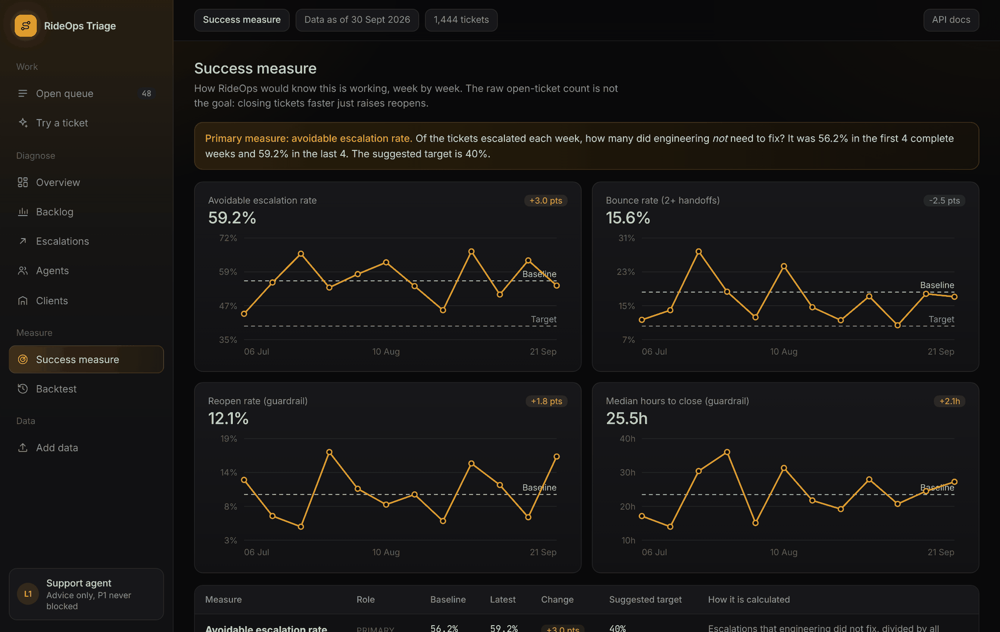
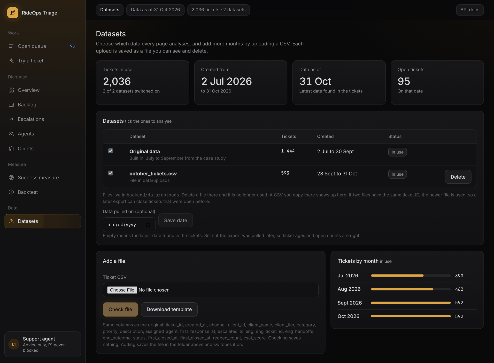
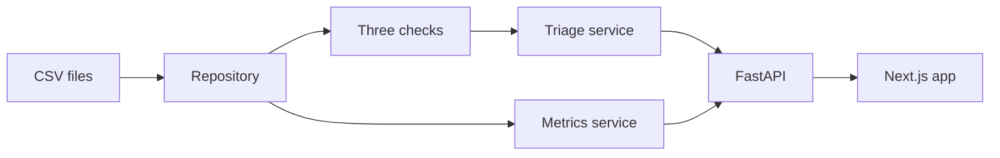

<div align="center">

# 🚖 RideOps Triage

### Tells a support agent exactly what to do with every open ticket, and shows the lead *why* the backlog keeps growing.


<br>

[Quick start](#-quick-start)&nbsp;&nbsp;·&nbsp;&nbsp;[What it does](#-what-it-does)&nbsp;&nbsp;·&nbsp;&nbsp;[Findings](#-what-the-data-says)&nbsp;&nbsp;·&nbsp;&nbsp;[How it works](#how-it-works)

<br>



<br>

</div>

---

## 🎯 The problem

RideOps runs employee cabs. Its support team is drowning: **open tickets are up about 60% since July.**

This tool answers two questions:

1. **Why** is the backlog growing?
2. **What can an L1 agent do about it today?**

> v0 built on the case-study data: **1,444 tickets, 2 Jul to 30 Sep 2026**.

## 📊 What the data says

| Finding | Number |
|---|---|
| Ticket volume, July to September | **+52%** (390 → 592) |
| Escalations that were **not real fixes** | **57%** (275 of 486) |
| Median time to close, 0 handoffs vs 3 | **12.6h vs 169.9h** |
| Open tickets waiting on **L1**, not engineering | **34 of 48** |
| Fastest agent's reopen rate (team: 11%) | **30%** |

> **The backlog grows from more volume plus an escalate-and-bounce loop**, not only from slow engineering.

## ✨ What it does

**For the L1 agent**

- **Open queue:** every open ticket gets tags and *one* recommended action, with the reason.
- **Details to have ready:** what to collect *before* escalating, so engineering does not send it back.
- **Similar earlier tickets:** how past tickets with the same issue ended.
- **Closing checklist and reopen risk:** so a fast close does not come back.
- **Try a ticket:** type a new issue and get advice before escalating.
- **Agree / Disagree** on every piece of advice, so a pilot can measure usefulness.

**For the support lead**

- **Backlog, Escalations, Agents, Clients:** where the backlog comes from and what each handoff costs.
- **Success measure:** weekly baseline, latest and target for six measures.
- **Backtest:** would the predictions have worked in the past?
- **Datasets:** upload more months, with row-by-row validation.

<table>
<tr>
<td width="50%"><br><sub><b>Open queue</b>: what to do, why, and what to collect</sub></td>
<td width="50%"><br><sub><b>Success measure</b>: tracked week by week</sub></td>
</tr>
<tr>
<td colspan="2"><br><sub><b>Datasets</b>: tick which data to analyse, upload new months</sub></td>
</tr>
</table>

## 🚀 Quick start

The whole project runs with **one command** using Docker.

### 1. Install Docker

Install [Docker Desktop](https://www.docker.com/products/docker-desktop/) and make sure it is running. (Linux: install Docker Engine with the Compose plugin.)

### 2. Get the code

```bash
git clone https://github.com/<your-username>/RideOps.git
cd RideOps
```

### 3. Start it

```bash
docker compose up --build
```

The first build takes a few minutes. Wait until you see the frontend and backend running.

### 4. Open it

| What | URL |
|---|---|
| **The app** | http://localhost:3000 |
| API docs (Swagger) | http://localhost:8000/docs |
| Health check | http://localhost:8000/api/health (should show `"tickets":1444`) |

### 5. Stop it

Press `Ctrl + C`, then:

```bash
docker compose down
```

<details>
<summary><b>Troubleshooting</b></summary>

| Problem | Fix |
|---|---|
| `Cannot connect to the Docker daemon` | Start Docker Desktop and try again |
| Port 3000 or 8000 already in use | Stop the program using it, or change the left side of `"3000:3000"` / `"8000:8000"` in `docker-compose.yml` |
| Saving an upload fails on Linux | Run `chmod a+rwx backend/data/uploads` |
| Page says "No ticket data is in use" | Open **Datasets** and tick at least one dataset |
| Want a completely fresh start | `docker compose down -v` (also removes saved feedback and dataset choices) |

</details>

## 🧭 Pages

| Page | For | What it shows |
|---|---|---|
| **Open queue** | L1 agent | Open tickets with tags and one recommended action. Click a ticket for details |
| **Try a ticket** | L1 agent | Type a new issue and see what to collect before escalating |
| **Overview** | Everyone | The four findings above |
| **Backlog** | Lead | Created, closed and open per week. Which categories grew |
| **Escalations** | Lead | How escalations ended and what each handoff costs |
| **Agents** | Lead | Speed next to escalation and reopen rates |
| **Clients** | Lead | Whether one client drives escalations |
| **Success measure** | Lead, Head of Ops | Weekly baseline, latest and target for six measures |
| **Backtest** | Lead | Would the predictions have worked in the past? |
| **Datasets** | Lead | Pick which data to analyse. Upload more months |

## 🏷️ Tags

Solid tags are **facts** read from the data. Dashed tags are **predictions** learned from past tickets.

| Tag | Type | Meaning |
|---|---|---|
| Lack of info, Config check, Duplicate, How-to, Not reproducible | Fact | Engineering sent it back for this reason |
| Fix ready | Fact | Engineering fixed it. Confirm and close |
| Bouncing | Fact | 2 or more handoffs between L1 and engineering |
| Reopened | Fact | The client reopened it before |
| P1 | Fact | Critical. Never held |
| Similar to history | Prediction | Same issue as many earlier tickets |
| Collect info first | Prediction | This category often comes back for info |
| Reopen risk | Prediction | Similar tickets are often reopened |

> All advice is a suggestion. **Nothing is blocked, and P1 tickets are never held.**

<a id="how-it-works"></a>
## ⚙️ How it works



**Three checks** produce the advice:

| Check | Question it answers |
|---|---|
| **Escalation gate** | What was engineering missing, and what should L1 collect first? |
| **Known-issue matcher** | Have we seen this issue many times, and how did it end? |
| **Reopen guard** | Will this come back if I close it, and what should I check first? |

**Learning is counting**: repeated issues, return rates and reopen rates. No machine learning, so every tag can be explained.

**Tech stack**

| Layer | Tech |
|---|---|
| Backend | Python 3.12, FastAPI, pandas (no database) |
| Frontend | Next.js 15 (App Router), React 19, TypeScript |
| Packaging | Docker Compose, multi-stage builds, health checks |

<details>
<summary><b>Choose and upload your data</b></summary>

Open **Datasets**. Every CSV is a dataset, and you tick the ones every page should analyse.

| Dataset | Where it lives |
|---|---|
| **Original data** (Jul to Sep 2026) | `backend/data/rideops_support_tickets.csv` |
| **Anything you upload** | `backend/data/uploads/*.csv`, one file per upload |

- **Upload:** choose a file, press **Check file**, review, then **Save and use**. Problems are listed by row and column. Nothing is saved until you confirm.
- **Drop one in:** copy a CSV (same columns as the original) into `backend/data/uploads/` and it appears on the page.
- **Delete:** delete the file, or press Delete on the page. The app stops using it. No restart needed.
- **Mix them:** if two files have the same ticket ID, the **newer file wins**, so a later export can close old tickets.
- **"Today"** is the latest date in the chosen data. You can set a "data pulled on" date instead.
- Docker mounts `backend/data/uploads`, so uploaded files appear on your machine.

The expected columns are in `backend/data/rideops_data_dictionary.csv`.

</details>

<details>
<summary><b>Project structure</b></summary>

```
RideOps/
├── backend/
│   ├── app/
│   │   ├── api/          routes: queue, metrics, backtest, data
│   │   ├── checks/       EscalationGate, KnownIssueMatcher, ReopenGuard
│   │   ├── models/       Ticket, Verdict
│   │   ├── repository/   the only code that reads the CSV
│   │   ├── services/     triage, metrics, history learner, backtester, datasets, feedback
│   │   ├── config.py     all thresholds and assumptions in one place
│   │   └── tags.py       tag names and meanings
│   ├── data/             original CSV + uploads/ folder
├── frontend/
│   ├── app/              one folder per page
│   ├── components/       charts, drawer, forms, sidebar
│   └── lib/              types, formatting, API helpers
├── docs/screenshots/     images used in this README
└── docker-compose.yml
```

</details>

<details>
<summary><b>API endpoints</b></summary>

Interactive docs: http://localhost:8000/docs

| Endpoint | Returns |
|---|---|
| `GET /api/health` | Status and ticket count |
| `GET /api/queue` | Open tickets with tags and advice |
| `GET /api/tickets/{id}` | One ticket with its advice |
| `POST /api/triage` | Advice for a typed ticket |
| `POST /api/feedback` | Agent agrees or disagrees |
| `GET /api/metrics/*` | `summary`, `weekly`, `yield`, `bounce`, `agents`, `categories`, `category-trend`, `top-clients`, `success` |
| `GET /api/backtest?split=YYYY-MM-DD` | Backtest result |
| `GET /api/data/status` | Every dataset and which are in use |
| `POST /api/data/upload?dry_run=true&name=file.csv` | Check a CSV (send it as the body). Use `false` to save it |
| `PUT /api/data/selection` | Choose datasets: `{"selected": ["original", "file.csv"]}` |
| `DELETE /api/data/datasets/{file}` | Delete an uploaded file |

</details>

## 🗺️ Next four weeks

| Week | Step |
|---|---|
| 1 | Add data for future months to enable long-term trend analysis. This will also support accurate month-over-month performance comparisons |
| 2 | Implement an automated system to reject tickets submitted with incomplete information any notifying client about the missing details |
| 3 | Create and integrate a comprehensive known-issue guide into the workflow for both support agents and engineers along with clear resolution steps |
| 4 | Introduce an automated weekly summary to evaluate overall performance. |

**Success means** avoidable escalations and bounces fall while reopens stay flat, not only a lower open count.

---
