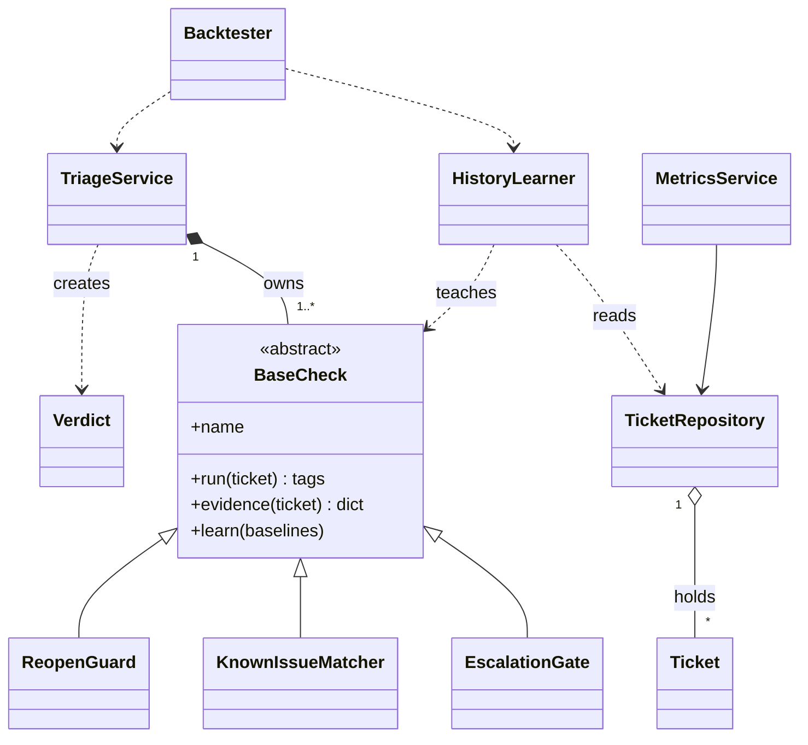

# RideOps Triage

A working v0 for the RideOps support case study. It helps an **L1 support agent** decide what to do with each open
ticket (resolve, collect info, link to a known issue, or escalate), and gives the **support lead** the numbers that
show where the backlog really comes from and how to track progress week by week.

It runs on the two CSV files from the brief. There is no live ticket system, by design.

---

## 1. How to start the project

You need **one** of: Docker, or Python 3.10+ (tested on 3.12).

### Option A: Docker (recommended)

```bash
git clone <your-repo-url> rideops-triage     # or unzip rideops-triage.zip
cd rideops-triage
docker compose up --build
```

Open **http://localhost:8000**. The API documentation is at http://localhost:8000/docs.

Run the tests inside Docker:

```bash
docker compose --profile test run --rm tests
```

Stop with `Ctrl+C`, then `docker compose down`. Agent feedback is kept in a Docker volume between restarts
(`docker compose down -v` deletes it).

### Option B: Python

```bash
cd rideops-triage
python -m venv .venv
source .venv/bin/activate            # Windows: .venv\Scripts\activate
pip install -r requirements.txt
uvicorn app.main:app --reload        # http://localhost:8000
```

Run the tests: `python -m pytest -q` (30 tests, under a second).
A `Makefile` has the same shortcuts: `make run`, `make test`, `make docker`, `make docker-test`.

### Check that it started

1. `http://localhost:8000/api/meta` returns JSON that says `"tickets": 1444` and `"open": 48`.
2. The app opens on the **Overview** page with "34 of the 48 open tickets are waiting on L1 to act".
3. `python -m pytest -q` ends with `30 passed`.

### If something goes wrong

| Problem | Fix |
|---|---|
| `port is already allocated` or `address already in use` | Something else uses port 8000. Change `"8000:8000"` in `docker-compose.yml` to `"8080:8000"`, or run `uvicorn app.main:app --port 8080` |
| `ModuleNotFoundError: app` | Run commands from the project root (the folder that contains `app/`), not from inside `app/` |
| Page loads but is empty with "Couldn't load this page" | The API is not running or crashed. Look at the terminal where it started |
| Text looks slightly different offline | The Inter font loads from Google Fonts. Without internet a system font is used. Nothing else is affected |
| `data/state` permission error on a mounted volume | Feedback is then not saved, but the app still works. Remove the volume line in `docker-compose.yml` |

---

## 2. Does it solve the case study?

The brief has four parts. This is where each one lives, and how far it is proven.

| Part | What is asked | Where it is | Status |
|---|---|---|---|
| 1. Diagnose | Back every claim with numbers | Overview, Backlog, Escalations, Agents and Clients pages, all computed from the CSV by `MetricsService` | **Done.** 30 tests, including a recomputation straight from the raw CSV |
| 2. Define success | What "better" means and how to measure it weekly | **Success measure** page and `GET /api/metrics/success`: one primary measure, one driver, one outcome and three guardrails, with baseline, latest and suggested targets | **Done** (targets are assumptions to agree with Ritika) |
| 3. Build a v0 | A working internal tool for one user that moves the measure | **Open queue** and **Try a ticket** for the L1 agent: tags and one recommended action per ticket, from `TriageService` | **Working.** Whether it moves the measure is **not proven**, see section 5 |
| 4. Four-week plan | Next steps and what not to do | Section 8 below | **Done** |

### The diagnosis in one paragraph

Open tickets rose because **volume rose 52%** (390 tickets in July, 592 in September) while median close time barely
moved (23.4h to 25.5h). The extra time per ticket comes from the escalate-and-bounce loop: only **211 of 486
escalations (43%)** were real engineering fixes, and the other 275 were sent back as missing info, config, duplicate,
how-to or not reproducible. Each handoff adds days: median close time is **12.6h** with no handoff and **169.9h** with three,
and CSAT falls from 4.0 to 2.1. **34 of the 48 tickets open on 30 Sep are waiting on L1 to act**, not on engineering,
because engineering already answered them. And "fast" is not "solved": the agent who closes fastest (Karan B, 11.9h) has
a reopen rate of about 30%, against 5% to 9% for the other agents.

### How this answers the three voices

* **Meera** (engineering is slow): in the open queue, 34 of 48 tickets are already answered by engineering and wait on L1. The data does not support "more people and faster engineering" as the main fix.
* **Sandeep** (support should do basic checks first): supported. 57% of escalations were avoidable. The tool turns that into a checklist at the moment of escalation.
* **Ritika** (bring the open number down, no budget): the tool needs no hires, and the Success measure page tracks the cause (avoidable escalations and bounces), because lowering the raw count by closing fast only raises reopens.

---

## 3. What you can do in the app

Each page has one job. Nothing is stacked on a single screen.

| Page | For | What it shows |
|---|---|---|
| **Overview** | Everyone | The four findings above, and what the tool does |
| **Open queue** | L1 agent | The 48 open tickets, most urgent first. Filter by tag, search (`/`), sort, export CSV. Click a row for the advice, step through tickets with the arrow keys, and mark it Agree or Disagree |
| **Try a ticket** | L1 agent | Type a new issue and tick the details you have collected. The advice changes as you tick |
| **Backlog** | Lead | Created, closed and open per week, tickets by month, which categories grew |
| **Escalations** | Lead | How escalations ended, what each handoff costs, categories |
| **Agents** | Lead | Speed next to escalations and reopens, with flags |
| **Clients** | Lead | Whether one company drives escalations (top 10, watch list, alert line) |
| **Success measure** | Lead, Ritika | The weekly measure: baseline, latest, change, suggested target |
| **Backtest** | Lead, reviewers | Learn from tickets before a date, replay the later escalations with outcomes hidden |

### Tags

Solid tags are **facts read from the CSV**. Dashed tags are **predictions** learned from past tickets.

| Tag | Kind | Meaning |
|---|---|---|
| `LACK_OF_INFO`, `CONFIG_CHECK`, `HOW_TO`, `NOT_REPRODUCIBLE`, `DUPLICATE` | fact | Engineering's recorded outcome sent the ticket back |
| `FIX_READY` | fact | Engineering fixed it and the ticket is still open: confirm and close |
| `BOUNCING` | fact | 2 or more handoffs |
| `REOPENED`, `P1` | fact | Reopened before, or critical (never blocked) |
| `SIMILAR_TO_HISTORY` | prediction | Same issue text (numbers ignored) as many earlier tickets |
| `COLLECT_INFO_FIRST` | prediction | The category often comes back for info or config |
| `REOPEN_RISK` | prediction | Category and agent history suggest a reopen |

All advice is a suggestion. Nothing is blocked, and P1 tickets are never held.

---

## 4. How to check that it works

1. **Run the tests.** They assert the headline numbers, recomputed independently from the raw CSV:
   1,444 tickets, 48 open (29 with L1, 19 with engineering), 486 escalated, 211 fixed, 275 avoidable, monthly volume 390 / 462 / 592,
   top client Horizon Infotech with 13, every extra handoff slowing close time, 34 open tickets waiting on L1,
   P1 never held, no future information leaking into the backtest, and clear errors for bad input.
2. **Spot-check tickets** in the Open queue: `SUP-11296` shows Lack of info, Bouncing and Reopened. `SUP-11379` shows Duplicate. `SUP-11366` shows Fix ready.
3. **Try a ticket.** Pick "Booking cutoff changed but roster still uses old cutoff", press Check, then tick the four details and check again. The "collect first" advice changes.
4. **Open the Success measure page.** The Avoidable escalation rate is the number to watch in a pilot.
5. **Click Agree or Disagree** on a few tickets, then open `/api/feedback/summary` for the agreement rate.

---

## 5. The honest result of the backtest

Learning from July and August (852 tickets) and replaying the 189 escalations of September, the tool flagged 44 to
"check first". 48% of those were avoidable, against 59% of all September escalations: a lift of 0.81, which is
**not better than chance**. On this split, category and issue text did not predict which escalations engineering would send back.

What this means for the claim "the tool lowers avoidable escalations":

* **Not proven.** The predictive tags (`SIMILAR_TO_HISTORY`, `COLLECT_INFO_FIRST`, `REOPEN_RISK`) are advice only.
* **Reliable without prediction:** the fact tags on the open queue read engineering's own outcome, so they are as accurate as the CSV.
* **The measure that decides it is the Success measure page.** Run a pilot and compare 4-week averages. A single week has only about 40 escalations, so it swings between 44% and 67% by chance.
* One signal was stable across July, August and September: agent **Rahul T** has 75% avoidable escalations over 93 escalations, against 40% to 63% for the others. That is a coaching conversation, not a ticket rule.
* No single client drives escalations: the top 3 clients are 6.6% of them.

---

## 6. Design

```
app/
  config.py              thresholds, paths and domain assumptions in one place
  tags.py                tag names, engineering outcomes, labels
  models/                Ticket, Verdict (plain data)
  repository/            TicketRepository: the only code that reads the CSV
  checks/                BaseCheck + EscalationGate, KnownIssueMatcher, ReopenGuard
  services/              HistoryLearner, TriageService, MetricsService, Backtester, FeedbackStore
  api/                   FastAPI routes (queue, metrics, backtest), request schemas, dependencies
  context.py             builds everything once at startup
  main.py                creates the app and serves the frontend
frontend/
  index.html             shell: sidebar, top bar, drawer
  css/styles.css         design tokens and components
  js/app.js              router (one hash route per page)
  js/api.js ui.js charts.js verdict.js drawer.js   shared helpers
  js/views/              one file per page: overview, queue, try, backlog, escalations, agents, clients, success, backtest
tests/                   pytest against the real CSV
data/                    the two CSV files from the brief
Dockerfile  docker-compose.yml  Makefile  requirements.txt
```

Dependencies point one way: `api` calls `services`, `services` use `checks` and `repository`, and everything uses `models`.



* **Repository.** `TicketRepository` hides the CSV, so moving to a database changes one class.
* **Strategy (is-a).** Each check inherits `BaseCheck` and implements `run(ticket)`. A new check is one new class.
* **Facade (has-a).** `TriageService` owns the checks. The screen calls `assess(ticket)` and never touches a check directly.
* **Learning is counting.** `HistoryLearner` counts repeated issues (digits ignored), returned-for-info rates and reopen rates. No machine learning.
* **No leakage in the backtest.** `Backtester` learns only from tickets before the split and calls `Ticket.masked()` so outcomes, handoffs and reopens are hidden when it predicts.

### API

| Endpoint | Returns |
|---|---|
| `GET /api/meta` | Tags, categories, required details, dates |
| `GET /api/queue` | Open tickets with verdicts, tag counts, totals (including `l1_action`) |
| `GET /api/tickets/{id}` | One ticket with its verdict |
| `POST /api/triage` | Advice for a manually typed ticket |
| `POST /api/feedback`, `GET /api/feedback/summary` | Agent agree or disagree, and the agreement rate |
| `GET /api/metrics/summary` `weekly` `yield` `bounce` `agents` `categories` `category-trend` `top-clients` | Diagnosis numbers |
| `GET /api/metrics/success` | The weekly success measure with baseline, latest and targets |
| `GET /api/backtest?split=2026-09-01` | Backtest result |

---

## 7. Backend review

The backend was checked against the four parts of the brief. Findings and what was done:

| Finding | Action |
|---|---|
| Part 2 asked for a measure tracked **week to week**, but only created, closed and open were weekly | Added `MetricsService.success()` and `/api/metrics/success` (weekly avoidable rate, bounce rate, reopen rate, median hours, CSAT, net backlog, with baseline and latest) |
| Meera's claim could not be tested from the queue | Added `l1_action`: 34 of 48 open tickets have an engineering answer and wait on L1 |
| The volume story needed a cause | Added monthly counts and `category-trend` (Cab delay +43, Report export +33 from July to September) |
| Predictive rules were unvalidated | Backtester with masked tickets. Result reported honestly: not better than chance |
| Known issues were grouped by exact text, so "17 employees" and "4 employees" were different | Digits are ignored when grouping |
| Bad input was accepted (blank description, `P9`, unknown ticket for feedback, backtest date outside the data) | Validated with clear 422 and 404 messages, each covered by a test |
| API tests wrote to the real feedback file | Tests use a temporary file |

Not verified in the build environment: the Docker image itself (the app and tests were run directly).

---

## 8. Assumptions, scope and next four weeks

**Assumptions**
* The CSV is the full history and 30 Sep 2026 is "now".
* Engineering outcomes are correct and L1 category labels are reliable enough to learn from.
* "Avoidable" means an escalation whose outcome was anything other than Fixed.
* **The CSV does not say which details engineering was missing.** The "details to have ready" lists in `app/config.py` are written from domain knowledge, not learned. The data only shows how often each category is sent back.
* Success targets (`SUCCESS_TARGETS` in `config.py`) are suggestions to agree with Ritika.
* Reopen and close-time figures for recent weeks are understated because open tickets are not counted yet.

**Deliberately not built:** live ticket intake (email, WhatsApp, portal), user accounts, notifications, machine learning, and any hard block on escalation. Each adds risk or effort without moving the measure in the first weeks.

**Next four weeks**
1. **Week 1.** Pilot the Open queue with two agents. Track the Agree rate and which tags they ignore.
2. **Week 2.** Make "what was missing" a required field when engineering returns a ticket. Replace the guessed checklists with real ones.
3. **Week 3.** Build a known-issue registry with engineering ticket IDs, so duplicates can be linked for real. Re-run the backtest on the new fields.
4. **Week 4.** Coach on the agent signals, then compare 4-week averages of avoidable escalation rate (baseline 56%), bounce rate and reopen rate.

Success is a falling avoidable-escalation rate and bounce rate with a flat or falling reopen rate, not only a lower open count.
